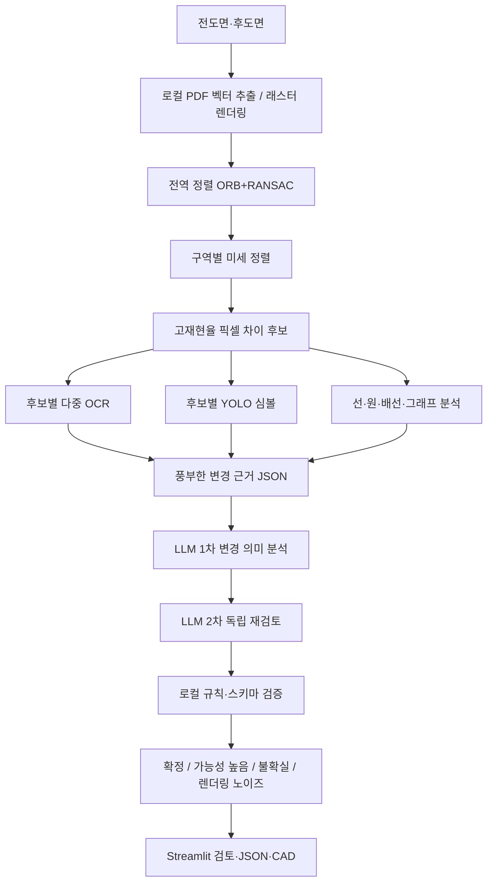

# LLM 적극 활용 도면 변경 분석 구조

## 목표

변경 검출은 작은 차이를 놓치지 않도록 로컬에서 민감하게 수행하고, LLM은 실제 OCR 값과 객체·연결 근거를 충분히 받아 변경의 의미를 판정한다. PDF와 원본 도면 이미지는 API에 포함하지 않는다.



## LLM 입력

후보마다 다음 정보를 함께 전달한다.

- 실제 전후 OCR 문자열, 신뢰도, bbox
- 추가·삭제 픽셀 수와 후보 영역
- 정렬 특징점 수, 내부점 비율, 변환행렬
- 주변 객체 ID, 종류, 클래스, 신뢰도, geometry
- 주변 그래프 edge와 연결 상태
- 로컬 규칙이 분류한 값·단위·속성 후보
- 1차 LLM 결과(2차 독립 재검토 시)

현재 실제 블라인드 샘플은 30개 후보, 전후 OCR 연결 179개, 약 67KB의 JSON을 만든다.

## LLM 출력

각 후보를 반드시 한 번씩 반환한다.

```json
{
  "change_id": "CHANGE_014",
  "verdict": "confirmed",
  "change_type": "text_value_changed",
  "before_value": "100 mm",
  "after_value": "120 mm",
  "affected_object_ids": ["DIMENSION_04"],
  "reason": "같은 치수선에 연결된 값이 변경됨",
  "confidence": 0.96,
  "needs_review": false
}
```

`verdict`는 `confirmed`, `probable`, `uncertain`, `rendering_noise` 중 하나다. OCR이 실패했지만 픽셀 모양이 달라졌다면 값을 발명하지 않고 `text_unreadable_changed`와 `needs_review: true`를 반환한다.

## 역할 분담

| 단계 | 담당 |
|---|---|
| 좌표 정렬·픽셀 차이·배선·CAD | 로컬 Python/OpenCV |
| 숫자·문자 읽기 | 로컬 PaddleOCR |
| 심볼 검출 | 로컬 YOLO |
| 단위·정규식·응답 스키마 검증 | 로컬 Python |
| OCR 문맥 보정·객체 관계·실제 변경 판정·설명 | LLM |
| 불확실하거나 설계 영향이 큰 변경 승인 | 사용자 |

## 전송 경계

새 풍부한 모드는 실제 OCR 문자열, 좌표, 객체와 연결 근거를 외부 API에 보낸다. 원본 PDF, 원본 이미지, crop 이미지와 파일 경로는 보내지 않는다. 회사가 파생 구조 정보 전송을 허용해야 사용한다. Streamlit의 명시적 전송 허용 체크박스가 켜진 경우에만 호출한다.

기존 최소 범주 전송 모드는 레거시 관계 확인 기능으로 유지한다. 새 변경 비교는 `llm_revision.py`의 풍부한 구조화 경계를 사용한다.
